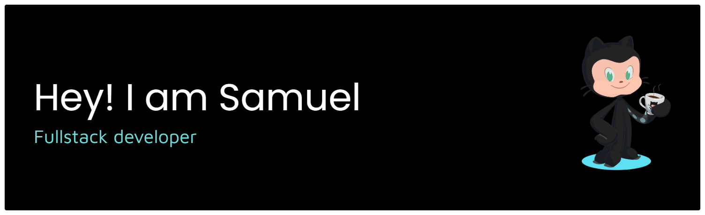

<h3 align="center">Software Developer at <a href="https://samuel-dorkey.vercel.app">Sloane.Dev</a></h3>

<p align="center">
  I design and develop modern web applications, platforms, and digital tools that solve real-world problems. From frontend experiences to backend systems and APIs, I build functional, scalable solutions tailored to their purpose.
</p>

## Featured Projects

<table>
  <tr>
    <td colspan="2" width="66%" valign="top">
      <h3><a href="https://github.com/Sloane-J/Q-Vault-AdonisJS">Q-Vault Adonis</a></h3>
      <p>A school platform for organizing, uploading, and accessing past examination papers.</p>
      <p>
        <code>AdonisJS</code>
        <code>EdgeJS</code>
      </p>
    </td>
    <td rowspan="2" width="34%" valign="top">
      <h3><a href="https://github.com/Sloane-J/Youtube-Video-Downloader">YouTube Downloader</a></h3>
      <p>A web-based tool for downloading videos and playlists with flexible quality options.</p>
      <p>
        <code>Python</code>
        <code>Flask</code>
      </p>
    </td>
  </tr>

  <tr>
    <td width="33%" valign="top">
      <h3><a href="https://github.com/Sloane-J/Q-Vault">Q-Vault</a></h3>
      <p>The original Laravel implementation of the Q-Vault platform.</p>
      <p>
        <code>Laravel</code>
        <code>Blade</code>
        <code>Livewire</code>
      </p>
    </td>
    <td width="33%" valign="top">
      <h3><a href="https://github.com/Sloane-J/samueldjr">Portfolio</a></h3>
      <p>My personal portfolio showcasing projects, skills, and experience.</p>
      <p>
        <code>Astro</code>
        <code>React</code>
      </p>
    </td>
  </tr>
</table>
```
